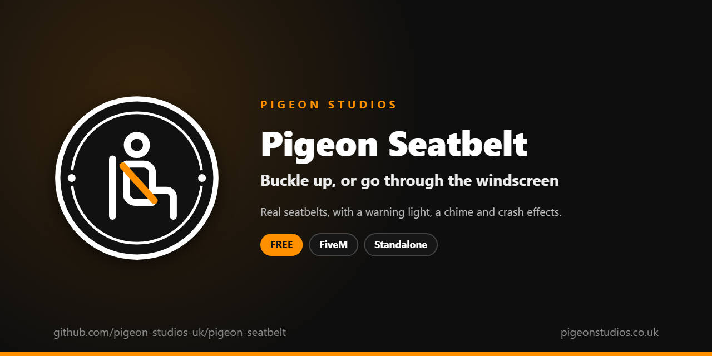

<div align="center">
  

  <h1>Pigeon Seatbelt</h1>

  <p><strong>Buckle up with a key, or go through the windscreen in a crash, with a warning light and a chime.</strong></p>

  <p>
    <a href="https://github.com/pigeon-studios-uk/pigeon-seatbelt/releases/latest"></a>
    <a href="LICENSE.md"></a>
    <a href="https://discord.gg/2NFVWEUmDF"></a>
    
  </p>

  <p>
    <a href="https://github.com/pigeon-studios-uk/pigeon-seatbelt/releases/latest"><strong>Download</strong></a> ·
    <a href="#installation">Install</a> ·
    <a href="#configuration">Configure</a> ·
    <a href="CHANGELOG.md">Changelog</a> ·
    <a href="https://discord.gg/2NFVWEUmDF">Support</a>
  </p>
</div>

---

## Contents

- [Overview](#overview)
- [Features](#features)
- [How players use it](#how-players-use-it)
- [Requirements](#requirements)
- [Installation](#installation)
- [Updating](#updating)
- [Configuration](#configuration)
- [For HUDs and other resources](#for-huds-and-other-resources)
- [Localisation](#localisation)
- [How it works](#how-it-works)
- [Update checker](#update-checker)
- [Performance](#performance)
- [Security](#security)
- [Troubleshooting](#troubleshooting)
- [FAQ](#faq)
- [Support](#support)
- [Contributing](#contributing)
- [Licence](#licence)
- [Credits](#credits)

## Overview

Pigeon Seatbelt is a free resource by [Pigeon Studios](https://pigeonstudios.co.uk) that gives your server real seatbelts. Players buckle up with one key. Unbuckled, a hard crash throws them through the windscreen; buckled, they stay in their seat. A warning light and a chime remind them, like a real car, and a hard crash leaves them shaken for a while either way.

The ejection is GTA's own: the game already knows how to throw a character through a windscreen, with its own physics, and every player sees it. This resource decides who it happens to, and from what speed.

## Features

- **One key.** B by default, which players can change in GTA's key bindings, or `/seatbelt`. A click tells them it worked.
- **Through the windscreen.** Unbuckled players are thrown out in a hard crash, from a speed you set. Buckled players never are.
- **Getting out.** While buckled, the first press of F takes the belt off and the next gets them out. Or block getting out until they unbuckle, or let them out straight away.
- **Warning light.** A blinking seatbelt light on screen while unbuckled, from a speed you choose, in any corner.
- **Chime.** A soft chime while unbuckled at speed, like a real car's. Only that player hears it.
- **Shaken after a crash.** A camera jolt, a blurred screen and a dazed walk, stronger and longer the harder the crash.
- **Right vehicles only.** Nothing happens on motorcycles, bicycles, boats or trains, or any vehicle you list.
- **Works with your HUD.** A state bag, an event and exports let any HUD show the belt, and let police resources check it.
- **No files to license.** The warning light is drawn by us, and the sounds are made as they play.
- **23 languages.** Every message is in `locales/`, and it follows ox_lib's language setting.
- **Standalone.** No framework needed.

## How players use it

1. Get in a vehicle. They start unbuckled.
2. Press **B** (or type `/seatbelt`) to buckle up. Press it again to unbuckle.
3. Getting out while buckled: press **F** once to unbuckle, then **F** again to get out.

Unbuckled and moving, the seatbelt light blinks in the corner of the screen, and from 15 mph a chime sounds until they buckle up or slow down.

To change the key: **Settings → Key Bindings → FiveM → Seatbelt on / off**.

## Requirements

| Requirement | Version | Notes |
|---|---|---|
| FXServer | A [recommended artifact](https://runtime.fivem.net/artifacts/) | |
| [ox_lib](https://github.com/communityox/ox_lib) | Optional | Used for messages if it's running and `Config.ShowMessages` is on |

**Frameworks:** none needed. It works the same on standalone servers, ESX Legacy, QBCore, Qbox and ox_core.

## Installation

1. **Download** `pigeon-seatbelt.zip` from the [latest release](https://github.com/pigeon-studios-uk/pigeon-seatbelt/releases/latest). Don't use the green **Code** button; release zips are the tested builds.
2. **Extract** it into your server's `resources` folder. The folder must be called `pigeon-seatbelt`.
3. **Start it** by adding this to `server.cfg`:

   ```cfg
   ensure pigeon-seatbelt
   ```

4. **Stop any other seatbelt resource**, including one built into your HUD, so players don't have two (see [Troubleshooting](#troubleshooting)).
5. **Check the settings** in `configuration/config.lua` (see [Configuration](#configuration)). Out of the box, unbuckled players are thrown out from 45 mph, the light shows from 10 mph and the chime from 15 mph.
6. **Restart** your server. The console shows one line from the update checker:

   ```text
   [Pigeon Studios] Pigeon Seatbelt v1.0.0 is up to date.
   ```

## Updating

1. Read the [changelog](CHANGELOG.md) for every version between yours and the latest, especially any **Upgrade notes**.
2. Back up your `configuration/` and `locales/` folders.
3. Replace the `pigeon-seatbelt` folder with the new release.
4. Copy your settings into the new `configuration/config.lua`. Don't copy the old file over the new one; new versions can add settings.
5. Restart the resource.

## Configuration

All settings are in `configuration/config.lua`, each with a comment explaining it. Every speed is in `Config.SpeedUnit`.

| Setting | Default | What it does |
|---|---|---|
| `Config.Locale` | `'auto'` | Language: `'auto'` follows ox_lib's language, or a code from `locales/` such as `'de'` |
| `Config.Key` | `'B'` | The default key. Players can change it in GTA's key bindings |
| `Config.Command` | `'seatbelt'` | The command, which the key runs |
| `Config.ExitWhileBuckled` | `'unbuckle'` | Getting out while buckled: `'unbuckle'` (first F unbuckles), `'block'` (unbuckle yourself first) or `'allow'` |
| `Config.ShowMessages` | `false` | A message on buckling and unbuckling, as well as the click |
| `Config.Notifications` | `'auto'` | `'auto'` (ox_lib if it's running), `'ox_lib'` or `'gta'` |
| `Config.EjectSpeed` | `45` | How fast the vehicle has to be going for an unbuckled player to be thrown out in a crash. GTA's own is about 78 mph |
| `Config.SpeedUnit` | `'mph'` | `'mph'` or `'kmh'` |
| `Config.CrashEffects.enabled` | `true` | The jolt, blur and dazed walk after a hard crash |
| `Config.CrashEffects.minSpeedLoss` | `25` | The least speed lost in a moment that counts as a crash |
| `Config.CrashEffects.fullSpeedLoss` | `70` | Speed lost for the full effect |
| `Config.CrashEffects.seconds` | `12` | How long the full effect lasts; lighter crashes are shorter |
| `Config.CrashEffects.shake`, `blur`, `dazedWalk` | `true` | Each part of the effect on its own |
| `Config.Indicator.enabled` | `true` | The warning light. Turn it off if your HUD shows its own |
| `Config.Indicator.minSpeed` | `10` | The light only shows from this speed. `0` whenever they're in a vehicle with seatbelts |
| `Config.Indicator.position` | `'bottom-right'` | `'bottom-right'`, `'bottom-left'`, `'top-right'` or `'top-left'` |
| `Config.Indicator.offsetX`, `offsetY` | `330`, `40` | Move it from that corner, in pixels at 1080p |
| `Config.Chime.enabled` | `true` | The chime |
| `Config.Chime.minSpeed` | `15` | The chime only sounds from this speed |
| `Config.Chime.volume` | `0.35` | `0.0` to `1.0` |
| `Config.ClickVolume` | `0.5` | The click's volume, `0.0` to `1.0` |
| `Config.Vehicles.noBeltClasses` | 8, 13, 14, 21 | Vehicle classes with no seatbelts: motorcycles, cycles, boats, trains |
| `Config.Vehicles.noBeltModels` | `{}` | Vehicles with no seatbelts, by spawn name |
| `Config.Vehicles.beltModels` | `{}` | Vehicles with seatbelts even though their class has none |

**Vehicle classes:** 0 compacts · 1 sedans · 2 SUVs · 3 coupes · 4 muscle · 5 sports classics · 6 sports · 7 super · 8 motorcycles · 9 off-road · 10 industrial · 11 utility · 12 vans · 13 cycles · 14 boats · 15 helicopters · 16 planes · 17 service · 18 emergency · 19 military · 20 commercial · 21 trains · 22 open wheel. [The full list](https://docs.fivem.net/natives/?_0x29439776AAA00A62).

## For HUDs and other resources

**State bag.** Each player's `seatbelt` state bag is `true` while they're buckled, and is replicated, so every resource on the server and in every game can read it:

```lua
-- Client: the player's own belt.
local buckled = LocalPlayer.state.seatbelt

-- Server: any player's belt, for example for a police check.
local buckled = Player(source).state.seatbelt
```

**Event**, on the client, whenever the player buckles or unbuckles:

```lua
AddEventHandler('pigeon-seatbelt:changed', function(buckled)
    -- update your HUD
end)
```

**Exports:**

```lua
-- Client
local buckled = exports['pigeon-seatbelt']:IsBuckled()
exports['pigeon-seatbelt']:SetBuckled(true)   -- for example from a vehicle menu; does nothing outside a vehicle with seatbelts

-- Server
local buckled = exports['pigeon-seatbelt']:IsBuckled(source)
```

If your HUD shows the belt itself, set `Config.Indicator.enabled = false`.

## Localisation

Pigeon Seatbelt comes in 23 languages: `en` English, `cs` Czech, `da` Danish, `de` German, `es` Spanish, `et` Estonian, `fi` Finnish, `fr` French, `hr` Croatian, `hu` Hungarian, `id` Indonesian, `it` Italian, `nl` Dutch, `no` Norwegian, `pl` Polish, `pt` Portuguese, `pt-br` Brazilian Portuguese, `ro` Romanian, `sl` Slovenian, `sv` Swedish, `tr` Turkish, `zh-cn` Simplified Chinese and `zh-tw` Traditional Chinese. They're the languages ox_lib ships, so your server may already have one set.

With `Config.Locale = 'auto'` (the default), it uses ox_lib's language, so one line in `server.cfg` sets it for this and every other resource that follows ox_lib:

```cfg
setr ox:locale "de"
```

Use `setr`, not `set`, so players' games get it too. Without it, or for a language that isn't in `locales/`, the text is English. To choose a language for this resource only, set `Config.Locale` to its code, such as `'fr'` or `'pt-br'`.

Chinese text can show as blank in GTA's own text, such as its notifications and help messages, because GTA only loads its Chinese font when the game itself is set to Chinese. ox_lib's notifications show every language.

Every file was checked for missing text and placeholders, but not every translation has been read by a native speaker yet. If something reads wrong, please send a fix; see [Contributing](#contributing). To add a language, copy `locales/en.lua` to a new file named with the language's code (such as `ja.lua`), change `Locales.en` at the top to match (`Locales.ja`), and translate the text in quotes.

## How it works

GTA characters have a setting that decides whether they can be thrown through the windscreen in a crash, and the game has a speed a vehicle has to be going for that to happen. When the resource starts, it sets that speed from `Config.EjectSpeed`. Then, while the player is in a vehicle with seatbelts, it keeps their setting on while they're unbuckled and off while they're buckled. Everything else (the crash, the physics, the character flying out) is the game's own, which is why everyone sees it.

Every frame in a vehicle, it also:

1. handles the exit key while buckled, as `Config.ExitWhileBuckled` says;
2. measures the speed lost over each tenth of a second, and treats a big enough loss as a crash, for the effects;
3. tells the screen whether to show the warning light and play the chime.

Getting out, or being thrown out, always takes the belt off. Being thrown out at speed counts as the hardest crash for the effects. When the resource stops, the game's own ejection speed is put back.

The warning light and sounds are a small web page the game shows on top of the screen. It has no buttons and nothing to click, and only the player sees and hears it.

## Update checker

When it starts, Pigeon Seatbelt checks our public [version registry](https://github.com/pigeon-studios-uk/pigeon-versions) once and prints one line in the server console saying whether it's up to date. If there's an update, it shows what's new and where to get it. The check is a single request to GitHub and sends nothing about your server or players.

Control it for every Pigeon Studios resource at once in `server.cfg`:

```cfg
set pigeon_update_check "on"      # default: one short line
set pigeon_update_check "quiet"   # only print when there's an update or a problem
set pigeon_update_check "off"     # never check
```

## Performance

Outside a vehicle it checks four times a second and does nothing else. In a vehicle it runs every frame, which costs very little: a speed reading and a setting kept in step. The screen is only told when something changes. Nothing runs on the server apart from the update check at start-up.

## Security

- It only changes the player's own character, in their own game.
- The `seatbelt` state bag is set by each player's own game. Treat it like anything a player's game reports: fine for a HUD or a roleplay check, not proof for an anti-cheat.
- It has no network events and its web page has no callbacks, so there's nothing players or other resources can send it, apart from the exports, which only resources on your server can call.
- The only network request is the update check at start-up, from the server to GitHub. It sends nothing about your server or players.

Found a problem? Please don't open a public issue. Use the **Report a vulnerability** button in this repository's **Security** tab, or follow our [Security Policy](https://github.com/pigeon-studios-uk/.github/blob/main/SECURITY.md).

## Troubleshooting

**Players are thrown out even when buckled, or never thrown out.**
Another resource may be changing the same setting, often a HUD with its own seatbelt, or another seatbelt resource. Stop it and test again. Check `Config.EjectSpeed`: below it, nobody is thrown out.

**Two seatbelt lights, or two chimes.**
Your HUD has its own seatbelt. Turn off its seatbelt, or set `Config.Indicator.enabled = false` and `Config.Chime.enabled = false` here and let your HUD read the state bag.

**No sound.**
Check `Config.Chime.volume` and `Config.ClickVolume`, and the game's own volume. The sounds play through the game's interface audio.

**The light is in the wrong place, or under my HUD.**
Change `Config.Indicator.position`, `offsetX` and `offsetY`.

**Pressing F doesn't get me out.**
With `Config.ExitWhileBuckled = 'unbuckle'`, the first F takes the belt off; press F again. With `'block'`, press B to unbuckle first.

**The console says "isn't in the version registry" or "couldn't check for updates".**
Your server couldn't reach GitHub, or the check is blocked by a firewall. The resource works normally either way. Turn the check off with `set pigeon_update_check "off"`.

## FAQ

**Is it really free?**
Yes. Use it on as many servers as you like, including ones that take donations. You just can't reupload, resell or bundle it. See [Licence](#licence).

**Does it buckle NPCs?**
No. It only changes players. The ejection speed setting is the game's, though, so NPCs that can be thrown through windscreens use it too.

**Do other players see someone go through the windscreen?**
Yes. It's the game's own ejection.

**Does it work with Pigeon Lean Out?**
Yes. While leaning out, a player isn't in their seat, so they're not buckled; they buckle up again after coming back in.

## Support

Read [Troubleshooting](#troubleshooting) first, then ask in the support channels of our [Discord](https://discord.gg/2NFVWEUmDF). Please include your Pigeon Seatbelt version, FXServer artifact, your HUD and any errors from the console (F8 in game). See [Getting help](https://github.com/pigeon-studios-uk/.github/blob/main/SUPPORT.md).

Found a bug? Open a [bug report](https://github.com/pigeon-studios-uk/pigeon-seatbelt/issues/new/choose).

## Contributing

Fixes, improvements and translations are welcome. Please read the [contributing guide](https://github.com/pigeon-studios-uk/.github/blob/main/CONTRIBUTING.md) first, and open a feature request before working on anything big.

## Licence

Pigeon Seatbelt is free to use under the **[Pigeon Studios Free Licence](LICENSE.md)**.

- ✅ Use it on any number of servers, including monetised ones
- ✅ Change it for your own servers
- ✅ Show it in videos and streams
- ❌ Don't reupload, share or mirror the files; link to this repository instead
- ❌ Don't sell it, bundle it in packs, or put it behind escrow
- ❌ Don't remove the credits

This summary isn't the licence; [LICENSE.md](LICENSE.md) is. Third-party components are listed in [NOTICE.md](NOTICE.md).

## Credits

Made by [Pigeon Studios](https://pigeonstudios.co.uk). Thanks to everyone who has contributed fixes and translations; see the [changelog](CHANGELOG.md).

<sub>Not affiliated with or endorsed by Rockstar Games, Take-Two Interactive or Cfx.re.</sub>
